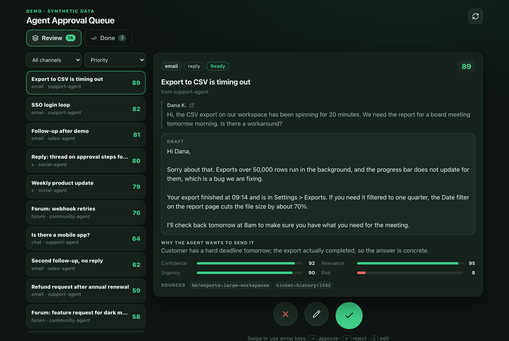
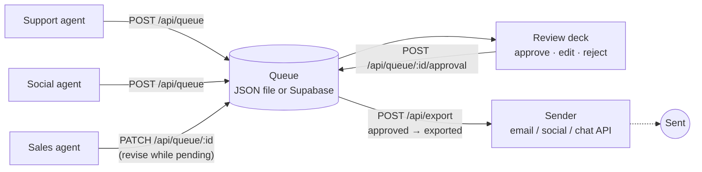
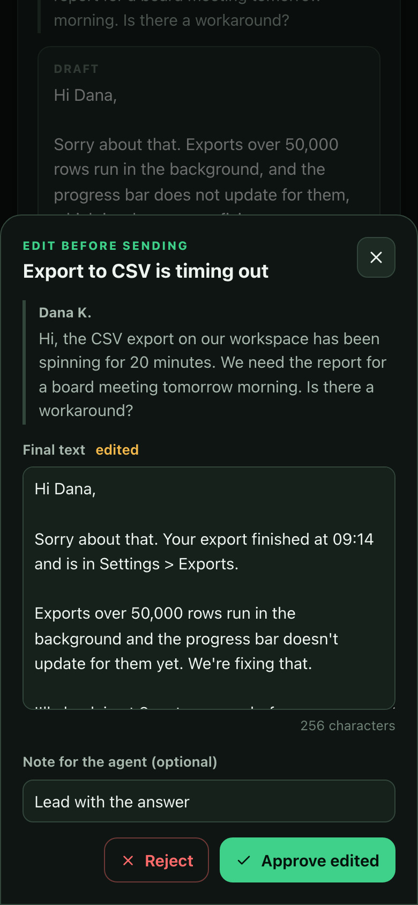

# agent-approval-queue

A review queue where AI agents submit drafts and a human approves, edits or rejects them before anything is sent.



## The problem

Agents are good at drafting replies, follow-ups and posts, and bad at knowing when a draft is wrong. Letting them send directly means a wrong refund amount, an invented fact or a tone-deaf public reply goes out under your name. Reviewing in the agent's own chat or in a spreadsheet doesn't scale either: drafts arrive from several agents and channels, nobody can tell which ones are urgent or risky, the same item gets drafted twice, and there's no record of what the human changed.

## Approach

Agents never get a send step. They `POST` drafts to a small HTTP API with context, a rationale, sources and four scores. A human works through the queue in a swipe deck (right approves, left rejects, up edits), sorted by priority. Approved items are exported as a batch to whatever does the sending, and the export retires them so nothing is sent twice.



Rules the API enforces:

- **Agents propose, humans decide.** Agents can create and revise drafts but cannot set `status` or `review`. Once a draft is decided, the agent can no longer change it (`409`).
- **Idempotent submission.** A `dedupeKey` or the normalised source URL identifies an item. A second submission returns `409` with the existing ID instead of creating a duplicate. In Supabase this is a unique column, so it holds under concurrent posts.
- **Edits are recorded.** Approving with changed text sets `review.edited`, and the reviewer can leave a note. That gives you an edit rate and reasons per agent.
- **Exports are exact batches.** `POST /api/export` with explicit IDs moves only those items to `exported`, so something approved mid-export isn't sent by accident.
- **No deletes.** Rejecting keeps a record of what each agent proposed.

Full contract with curl examples: [docs/api.md](docs/api.md).

## Results

No production numbers are published for this queue, so none are claimed here. It comes from a working tool for reviewing agent-drafted social replies, generalised and rebuilt for this repo.

What has been checked in this repo, on the synthetic data:

- `npm run build` passes (Next.js 16, TypeScript strict).
- Every status code in [docs/api.md](docs/api.md) was exercised with curl against `npm start`: 201, 400, 401 with the secret set, 404, 405, and 409 for duplicates, decided drafts, double approval and re-export.
- 20 concurrent `POST`s against the JSON store all landed (25 → 45 items), with no lost writes.
- `scripts/example-agent.mjs` submits drafts, gets `409` on a rerun, and `--collect` exports approved items, showing which ones the reviewer edited.

The rule behind it, that agents draft and a human approves every send, is the same one described in [My CRM is an agent system](https://tonytonggg.com/writing/my-crm-is-an-agent-system).

## Quickstart

Requires Node 20+.

```bash
npm install
npm run dev            # http://127.0.0.1:8790
```

On first run the app copies `data/seed.json` (20 **synthetic** drafts from fictional agents, people and companies, all tagged `synthetic`) to `data/queue.json`. No env vars or accounts are needed. `npm run seed` resets it.

In a second terminal, act as an agent:

```bash
npm run agent                      # submit 3 synthetic drafts
npm run agent -- --count 5         # submit 5 (already-queued ones come back 409)
# approve a few in the UI, then:
npm run agent -- --collect         # export approved drafts, as a sender would
```

Keyboard: `→` approve, `←` reject, `E` edit, `U` undo.



### Optional: Supabase

1. Run [docs/supabase.sql](docs/supabase.sql) in the Supabase SQL editor.
2. Copy `.env.example` to `.env.local` and set `SUPABASE_URL` and `SUPABASE_SERVICE_ROLE_KEY` (server-side only).

When both are set the app uses Supabase. Otherwise it uses the JSON file. On Vercel the JSON store refuses to run, because the file system doesn't persist there.

### Optional: agent secret

Set `QUEUE_API_SECRET` and agents must send it as `x-queue-api-secret` on `POST`/`PATCH`.

## Repo layout

```
app/
  page.tsx                      server component: loads the queue
  api/queue/route.ts            GET list, POST submit (agents)
  api/queue/[id]/route.ts       GET one, PATCH revise (agents)
  api/queue/[id]/approval/      POST approve | reject | reset (reviewer)
  api/export/route.ts           GET peek, POST export-and-retire (sender)
components/                     QueueApp, DeckView (swipe), DraftCard, EditSheet, DoneView
lib/
  queue.ts                      state rules: who can change what, when
  validate.ts                   strips server-owned fields from agent input
  dedupe.ts                     idempotency key + URL normalisation
  scoring.ts                    priority and the "ready / polish / read closely" gate
  store/                        JSON file store (with write lock) and Supabase store
scripts/
  example-agent.mjs             synthetic agent: submit drafts, collect approved ones
  reset-queue.mjs               restore data/queue.json from the seed
data/seed.json                  20 synthetic drafts
docs/                           api.md, supabase.sql, screenshots
```

## Design decisions

- **Server-owned IDs and status.** The original version let callers write whole items, so a buggy agent could mark its own draft approved. Parsing only agent-owned fields closes that.
- **Scores come from the agent, priority comes from the queue.** Agents report confidence, relevance, urgency and risk. The queue combines them into one priority number, so the formula can be tuned in one place for every agent.
- **Low confidence still reaches the human.** The gate labels drafts "Ready", "Needs polish" or "Read closely" rather than hiding them. Hiding drafts would mean an agent's bad day happens out of sight.
- **JSON file first.** Anyone can clone and run it with no accounts. Writes go through one promise chain and an atomic rename, which is enough for a single process. Supabase is the path for anything shared.

## What I'd do next

- Reviewer auth. The approval and export routes trust whoever can reach the app; in a real deployment they sit behind SSO or a proxy.
- Optimistic concurrency (`updatedAt` check) on the Supabase path, so two reviewers can't overwrite each other.
- A webhook back to the agent on reject or edit, so the reviewer's note becomes feedback rather than a CSV column.
- Per-agent edit and reject rates on a small dashboard, and auto-approve for an agent only once its edit rate stays near zero.
- Tests for `lib/queue.ts` and `lib/dedupe.ts`; today the contract is checked by hand with curl.

## Licence

MIT © Tony Tong. More at [tonytonggg.com](https://tonytonggg.com).
